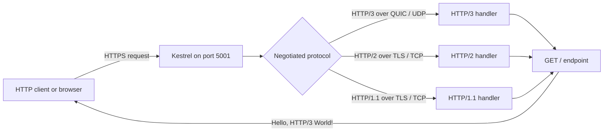

# HTTP/3 with ASP.NET Core and Kestrel

A minimal ASP.NET Core web app demonstrating how to enable **HTTP/3 over QUIC** with **Kestrel**. It listens for HTTPS traffic on port `5001`, enables HTTP/1.1, HTTP/2, and HTTP/3 on the endpoint, and returns a small greeting from `/`.

> **Target framework:** The project currently targets **.NET 9** (`net9.0`), despite `.NET8` in the repository name. Update the project file if you intend to run it on .NET 8.

## What this project demonstrates

- Configure Kestrel to support HTTP/1.1, HTTP/2, and HTTP/3.
- Require HTTPS for the configured endpoint; HTTP/3 uses QUIC over UDP.
- Serve a minimal `GET /` response: `Hello, HTTP/3 World!`.
- Expose OpenAPI in the Development environment.

This is a protocol configuration sample, not a complete reliability or failover system. HTTP/3 can improve behavior on some changing or lossy networks, but application-level retries, monitoring, and fallback policies are not implemented here.

## Architecture and data flow

The client establishes a secure connection to Kestrel. The client and server negotiate a supported HTTP version; HTTP/3 uses QUIC over UDP, while HTTP/1.1 and HTTP/2 can use TCP. Kestrel routes the request to the minimal API endpoint, which returns the greeting.



## Request sequence

```mermaid
sequenceDiagram
    autonumber
    actor Client
    participant Kestrel
    participant Endpoint as Minimal API: GET /

    Client->>Kestrel: Connect to https://localhost:5001
    Note over Client,Kestrel: Negotiate TLS and a supported HTTP version; HTTP/3 uses QUIC over UDP
    Client->>Kestrel: GET / using negotiated protocol
    Kestrel->>Endpoint: Dispatch request
    Endpoint-->>Kestrel: 200 OK — Hello, HTTP/3 World!
    Kestrel-->>Client: HTTPS response
```

## Requirements

- .NET 9 SDK (the project targets `net9.0`).
- A trusted HTTPS development certificate for local testing.
- A client with HTTP/3 support to verify HTTP/3 specifically. HTTP/3 requires UDP connectivity; firewalls or hosting environments that block UDP may prevent HTTP/3 connections.

## Run locally

From the repository root:

```bash
dotnet restore
dotnet dev-certs https --trust
dotnet run
```

Kestrel is configured in `Program.cs` to listen on port `5001` with HTTPS and the `Http1AndHttp2AndHttp3` protocols. Open `https://localhost:5001/` to see the greeting. The actual listening URL is defined in `Program.cs`; the `Http3WebAPI.http` sample currently points to a different HTTP address and a `/weatherforecast/` route that is not mapped by the active application.

To check the response with a client that supports HTTP/3, try:

```bash
curl --http3-only -k https://localhost:5001/
```

`-k` skips certificate validation and is suitable only for local testing. Remove it when using a trusted certificate. If the installed curl build lacks HTTP/3 support, use an HTTP/3-capable browser or client.

## Benefits of HTTP/3

- **QUIC transport:** combines transport security and connection setup, and avoids TCP-level head-of-line blocking between independent streams.
- **Improved connection behavior:** connection migration can help a connection survive some network changes, such as switching between Wi-Fi and cellular, when supported by the client and network.
- **Multiplexed streams:** concurrent requests can make progress independently, which can be useful on lossy networks.
- **Protocol negotiation:** this sample also enables HTTP/1.1 and HTTP/2 on its Kestrel endpoint for clients that do not use HTTP/3.

Benefits depend on clients, network conditions, TLS/certificate setup, and deployment configuration. HTTP/3 does not by itself guarantee faster performance or application availability.

## Example use cases

- Learning and demonstrating HTTP/3 configuration in ASP.NET Core and Kestrel.
- Testing HTTP protocol negotiation and client compatibility.
- Prototyping APIs for mobile or web clients that may use changing networks.
- Comparing HTTP/2 and HTTP/3 behavior in a controlled environment.

## Project structure

```text
.
├── Program.cs          # Kestrel setup and minimal API endpoint
├── Http3WebAPI.csproj  # .NET target framework and OpenAPI dependency
├── appsettings.json    # Kestrel and logging settings
└── Http3WebAPI.http    # Example HTTP request (currently needs updating)
```

## Search keywords

ASP.NET Core HTTP/3 example, .NET 9 HTTP/3, Kestrel HTTP/3 configuration, QUIC web API, HTTP/3 over UDP, enable HTTP/3 in ASP.NET Core, HTTP/1.1 HTTP/2 HTTP/3.

> Search ranking cannot be guaranteed by README changes alone. Accurate repository metadata, useful documentation, relevant project topics, working examples, and ongoing maintenance can help people discover the project; no change can guarantee a top-10 search position.
